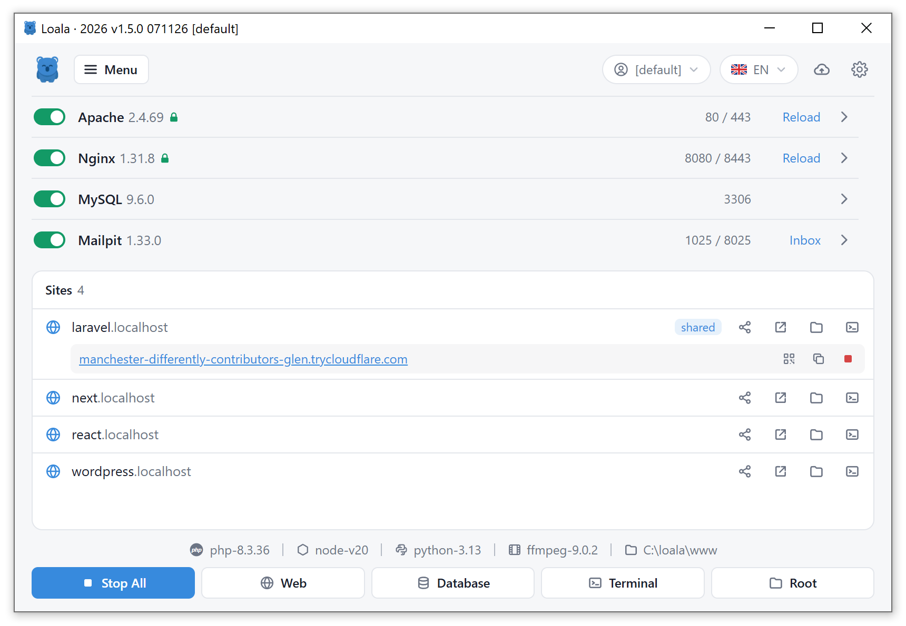

# Loala

  
  
  

**One local development environment for Windows and macOS.**

Web servers, databases and languages live in a single portable folder and are
managed from one window and the system tray. No system services, nothing to
configure by hand, and the same folder layout on both operating systems.

## Features

- **Sites** – every folder in `www` is served at `https://<name>.localhost`, certificate included.
- **Projects** – create WordPress, Laravel, Symfony, Next.js, Nuxt, Vite or Express in one click with Quick app, or clone from a Git URL. Existing projects, including CodeIgniter, are detected automatically; Node.js apps run, build and start from the Sites list.
- **Versions** – several PHP, MySQL, Node.js and Python versions side by side; install more with Quick add and switch from the menu.
- **Share** – publish any site on a public URL through Cloudflare Tunnel, random address or your own domain.
- **Tools** – built-in terminal, editor, listening-ports view, Procfile runner and cron jobs.
- **Updates** – see what's new and update from inside Loala, with each installer checked against its SHA256.
- **Portable** – move the folder or copy it to another machine; everything keeps working.

## Included

| Category | Packages |
|---|---|
| Web servers | Apache, Nginx |
| Databases | MySQL, PostgreSQL, MongoDB, Redis, Memcached |
| Languages | PHP, Node.js, Python, Go |
| Tools | phpMyAdmin, Adminer, Mongo Express, Mailpit, PocketBase, Composer, Git, ffmpeg, cloudflared |

## Install

Download the installer from [Releases](../../releases). Windows 10 or later, 64-bit.

Loala is not code-signed yet, so Windows SmartScreen may warn you on first run.
Choose **More info**, then **Run anyway**. To check the download, compare its
SHA256 with the value shown on the release page.

## Updating

From 1.11.0, Loala checks GitHub for new releases. Open **Update** (the download
icon at the top of the window) to see what's new and choose **Update now**.
Loala downloads the installer, checks its SHA256, and restarts after updating.
Automatic updates can be turned on in the same window.

You can also download the new installer and run it yourself (needed once to get
from 1.10 or earlier to 1.11.0).

- The installer finds your existing Loala and offers to update it in place.
- If Loala is running, close it from the tray icon (Exit) when asked.
- Your projects (`www`), databases (`data`), and settings (`usr`) are kept.
  Settings are also backed up to `backup\usr-before-<version>` first.
- Only `Loala.exe` and the bundled packages in `bin` are replaced.

Reinstalling the same version works the same way and is safe.
To start fresh instead, choose a different folder in the installer.

## Support

Loala is free to use. If it saves you time, you can support its development
with a donation on Saweria.

